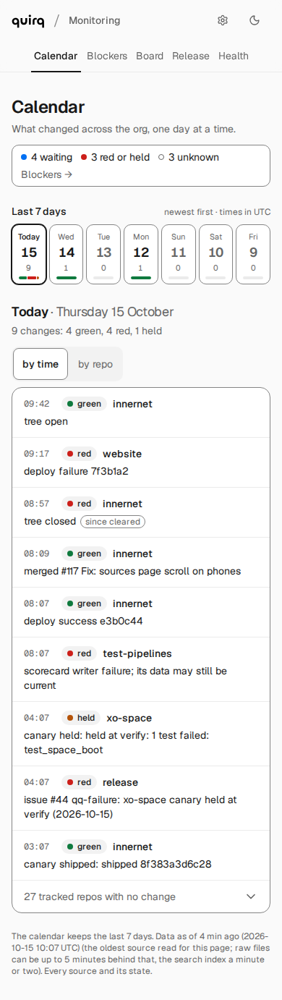

# monitoring

The quirq-ai monitoring dashboard: one page that says **what changed across the org and what state
everything is in**, on a phone or a desktop. suraj's Vercel project serves it at
[monitoring.quirq.dev](https://monitoring.quirq.dev/).

The dashboard is read-only. It reads the state the other repos already publish, shows it with the word
(`green`, `red`, `held`, `pending`, `unknown`, `stale`) before the color, and links every value to
the file or GitHub page it came from. It never merges, approves, comments or moves a ref. The one
part that changes anything is the **Settings** editor below, and it does so only with your own `gh`
login, only as pull requests (and, after a confirm step, org properties).



(Fixture data from the test server, not the live org.)

Every page at phone and desktop width, light and dark, is in the `screenshots` artifact of each
CI run.

## The pages

| Page | The question it answers |
|---|---|
| **Calendar** (`/`) | What changed, one day at a time. The last 7 days as a strip, today first, each with its count and a bar split by state; a day opens below (`?day=YYYY-MM-DD`), its changes by time, newest first (merged PRs, lkgr and channel moves, canary results, tree opened or closed, deploys, new failures, a writer whose last run failed), or by repo (`?view=repo`): one row per tracked repo with one dot per change, oldest left, opening into its entries. The repos with no change fold into one line. An alarm a newer event has cleared is marked "since cleared". One line on top carries the Blockers counts. Deploys and channel moves keep only their newest event, so an earlier day can show fewer of them than happened. |
| **Blockers** (`/blockers`, was `/waiting`) | Three counts on top (waiting on you; red or held; unknown, stale or failing), then what waits on you (PRs where you are a requested reviewer or assignee, PRs you approved on an older head, held canaries, open `qq-failure` issues), then what else is broken right now: red or held in the last 24 hours and not cleared since (a closed tree, a failed canary or deploy, a new failure, a writer whose last run failed), without repeating what waits on you. |
| **Board** (`/board`) | Every repo as a post-it note, one board per group, the notes that need a look first. On top, an overview indexes every repo by state; a tap jumps to its note. A note is tinted by its worst state (unknown is plain paper with a dashed edge); products and repos that need a look show CI on main, open PRs, last merge and for products also tree, lkgr, canary and deploy, the problems first. A green repo is a small note with its name. "needs a look" (`?show=look`) hides the rest. |
| **Release** (`/release`) | Per product: lkgr and each channel, the last 14 canary days as a strip, the hold if one is on, and the latest canary report. |
| **Health** (`/health`) | Whether each of the 9 scheduled writers ran on time, the scorecard, the gardener ledger, and every source this render read with its state. |
| **Gardener** (`/gardener`) | Is main green in the repos the gardener watches, and is the gardener working? Per watched repo (from the gardener's own status index, so website is not on it): the tree, its builders, uncovered commits, and each red range with its suspects by sha (never a commit title). Then whether the tree-status workflow runs on time and at its 5-minute pace, when each tree opened and closed (the last 100 tree-status commits), and why it only reports: the App (unknown: public data cannot show it), the ledger branch, `auto_land_repos` and the caps from infra-config `auto_revert.toml` at the gardener's pinned commit. Read-only. The failure type and failed steps of a red range are not published yet. |
| **Repo** (`/repos/<name>`) | One repo's Board row (CI, last merge; for a product also tree, lkgr, canary and deploy), its open PRs, the checks on its head, and for a product its tree builders, its canary strip and its perf metrics. |
| **Settings** (`/settings`, the gear in the header) | Edit what the infra is set up with: the gates (gate `settings/github.toml`, infra-config `gate.toml`, gate `guard/terms.toml`), the pins (`pins.toml` in gate, gardener, release, installer and test-pipelines, rollers `infra-config.commit`), the policies (every infra-config `config/*.toml`), the owners (org roles, repo owners and rotations in `org.toml`, each repo's `.github/CODEOWNERS`) and the org's custom properties per repo. On/off values are switches. Each product's `infra/repo.toml` is only linked, since its header says to read and edit it only through qqsync. Left out on purpose: toolchains `promoted.toml` ("written by `qqtc promote` … do not edit by hand") and `toolchains.toml` (qqtc's own registry and backend). See [The settings editor](#the-settings-editor). |
| **Snapshot** (`/api/snapshot`) | The same state as JSON (`qq-monitoring-snapshot/1`), for agents. `?since=7d` widens the window. |

Every tile shows the state first, then the detail, then where it came from and how old the data
says it is. Every link that leaves the dashboard (GitHub, Vercel) opens in a new tab; the page
links inside it stay in this one. A source that cannot be read shows `unknown` with the reason; a writer that has not run
inside its window shows `stale`, and so does every tile built from the files that writer keeps (the
tree, lkgr and canary tiles are only as current as the gardener and release jobs). A known fact
with no health in it ("nothing merged in 7 days") is plain text with no badge. When the GitHub API
as a whole is out (no token, rate limit, rejected token), one banner says so and the API tiles
read `unknown`. A count whose sources were not all read is a floor ("3+") or "?", never a green
zero. Nothing missing is ever shown as green.

**How old is what you see?** Calendar and Blockers say "data as of" the oldest read behind that page's own
sources (the hourly org repo list does not count), or "No data could be read" when none answered.
Each source is cached for 2 to 60 minutes (the windows are in [AGENTS.md](AGENTS.md)); after a
quiet night the first view is served from that cache while it refreshes, so a Board or Release
tile read more than twice its window ago is marked `stale` rather than shown as current, and the
counts and the Calendar and Blockers lists say "stale: read 50 min ago" when a read behind them is
that old. Raw files add up to 5 minutes on top of that, and the PR search index a minute or two.

## Run it

Node 20.9 or later (CI runs 24) and pnpm 11.28.2 (`corepack enable` installs the pinned one).

```sh
pnpm install --frozen-lockfile
pnpm dev                      # http://localhost:3000, state-branch tiles work with no token
```

Add a token to make the GitHub API tiles (PRs, checks, deploys, writer runs, issues) work:

```sh
cp .env.example .env.local    # then put a read-only token in GITHUB_TOKEN
```

The token is a classic personal access token with **no scopes** (see Deploy for the exact
settings and why not a fine-grained one). Without one those tiles read `unknown` under a "GitHub
token not set" banner, and everything read from the state branches still works.
`MONITORING_ORG` (default `quirq-ai`) is the org it reads; `MONITORING_OWNER` (default
`sharmasuraj0123`) is whose "waiting on you" it is.

Check a change before pushing (CI runs the same):

```sh
pnpm lint && pnpm typecheck && pnpm test && pnpm build && pnpm e2e
pnpm live                     # every source once against the real branches, one line each
```

`pnpm test` and `pnpm e2e` never touch the network: they read captured and synthetic files through
a small fixture server (`tests/fixtures/`), so a Playwright run at 390 and 1280 px, light and dark,
is the same every time. The screenshots land in `test-results/screenshots/`, and CI uploads them.

## The settings editor

`/settings` lists every value in those files with the comment written next to it, grouped by
section (`[[repo]] xo-space`, `[policy]`), with a search box. Change what you want, then **Review**:
the editor reads every file again (on the deployed site that read may be up to a minute old; the
script checks the live file before it writes), makes the change line by line (comments and layout stay as they
are, and the edited file must parse to the old one with only your values changed), and shows each
pull request as a diff. One pull request per repo, on a new `settings-editor/<repo>-<time>` branch,
never a push to `main`, so that repo's checks, CODEOWNERS, approvals and merge queue decide whether
it lands. The review names the code owners CODEOWNERS assigns the paths to; the project waits for
their review before merging (its own rule, except where gate's settings set `code_owner_review`,
today toolchains, and GitHub requires it once applied). Values that `qqcfg generate` reads
(toolchain pins, kind commands, generated builders, pool runners) and the kind, pool and repo
names they refer to are read-only here, since changing them means regenerating `generated/` and
workflows in a checkout (and `qqcfg deliver` for product repos). Merging is not taking effect:
the tools read infra-config at a commit they pin, so a policy change reaches each of them when its
pin moves, and a gate settings change reaches GitHub only when an org admin runs gate's settings
apply. Each card and pull request says which. Org custom properties have no file: they change on GitHub at once, so the review asks you to
tick a box first.

Every change is made with **your own GitHub login through [gh](https://cli.github.com)**. Nothing
signs in to this site and no token is kept. Two ways:

- **On the deployed site**, the review gives you a script, `settings-change.sh`. Run it with
  `bash settings-change.sh`: it uses only gh (macOS bash 3.2 is fine), ignores any token in the
  environment, checks that each file it edits is still the version on `main` the page read, and
  each property still its old value (and stops, writing nothing, if not), shows what it will do and waits for you to type `yes`.
- **On your machine**, `pnpm editor` in a checkout of this repo builds the site and serves it at
  `127.0.0.1:3020`. It checks gh is signed in (and runs `gh auth login` for you if not), then
  prints a link to `/settings`. From that page, **Open pull requests** does the same steps through
  your gh directly. The link carries a key for that run in its `#fragment`; writes are refused
  without it, and from any address but 127.0.0.1. `pnpm editor --port N` picks another port.

Signing in with GitHub on the deployed site itself would need a GitHub OAuth App, which only the
org owner can register; it is not set up.

## Where the data comes from

Only public data, from the repos that own it. Nothing is restated here.

- **State branches**: `release-state` in release (channels, lkgr and channel pointers, canary runs,
  holds, daily reports), `tree-status` in gardener, `results` in test-pipelines (scorecard,
  failure records), `perf-data` in perf. Read from raw.githubusercontent.com, which can be up to 5
  minutes behind. The daily canary report is Markdown, rendered as text and tables, never as HTML.
- **Config on main**: infra-config `config/repos.toml` (the products) and `config/channels.toml`
  (channel order and cadence), gate `settings/github.toml` (every repo behind the gate). This repo's
  `config/repos.json` adds only the repos neither names. Any public repo none of them knows shows
  under "Not in any registry".
- **The GitHub API**, with the token: PRs and reviews (one org-wide search, not a call per repo),
  check runs, deployments, the writers' workflow runs, `qq-failure` and `canary-report` issues, the
  org repo list.

The gardener `ledger` branch does not exist yet, so its tile reads `unknown: ledger not started`
until the gardener App lands. The one failure record on `results` today is a planted demo; it is
shown with a label and never counted.

Every path, schema, cache window and freshness rule is in [AGENTS.md](AGENTS.md), which is the
guide for the agents that build this. A PR that changes a source updates both files.

## Repos it covers

| Group | Repos | Also shows |
|---|---|---|
| Products | `xo-space`, `innernet`, `website` (from infra-config) | tree status, lkgr, canary, production deploy, perf (website is not in the canary yet, and gardener and perf publish nothing for it, so only its deploy carries data: its tree cell is unknown and its perf section says no metrics are recorded) |
| qq infra | every non-product repo in gate `settings/github.toml`: `infra-config`, `gate`, `test-pipelines`, `gardener`, `release`, `perf`, `rollers`, `toolchains`, `qq`, `sync`, `recipes`, `remote-build`, `installer` | whether their scheduled writers ran on time (Health) |
| Apps in progress | `euler`, `galileo`, `instants`, `quitter` | |
| Knowledge | `research`, `wiki`, `docs`, `marketing`, `.github` | |
| Other | `monitoring`, `setup`, `agent-skills`, `xo-cowork-api`, `environment`, `quirq_ai`, `quirqy` (`setup` and `agent-skills` are grouped here by this repo only; whether they go behind the gate is a separate decision) | |

## Deploy

Vercel's GitHub app builds `main` into the production deployment and every PR into a preview (both
show up in the repo's deployments and on the PR). The project needs one environment variable:

1. Create a classic personal access token at https://github.com/settings/tokens/new: note
   `monitoring.quirq.dev read-only`, expiration 90 days, **no scopes ticked**. Every call the
   dashboard makes is a public read; the token only buys the 5,000-an-hour limit. A classic token
   rather than a fine-grained one because GitHub documents the Checks API as a gap of fine-grained
   tokens, and the Board reads `commits/<branch>/check-runs`. (Observed, cause not established: on
   2026-10-07 a fine-grained token limited to "Public repositories" was refused with 403 on the
   writers' Actions runs endpoints while the rest answered. Health now shows GitHub's own message
   next to such a 403; read it before drawing a conclusion.)
2. In Vercel, Settings > Environment Variables, add it as `GITHUB_TOKEN`, marked **Sensitive**, for
   **Production and Preview**.
3. **Redeploy** (a variable change does not rebuild by itself), then open Health: the GitHub API
   card should read "answering, with a token", and nothing on the page should read "GitHub API
   refused". The API card alone is not the check: it goes unknown only when every GitHub read
   fails, so it stays green while the writers' runs or the check runs are refused.

Rotate the token before it expires: an expired one shows a "GitHub token rejected" banner and
breaks nothing else. `MONITORING_OWNER` and `MONITORING_ORG` can be set the same way.

## What is not built

- Search, history charts, gate drift, push alerts, PostHog signals, a GitHub App in place of the
  token (v1, not started).
- Anything else that writes: filing alert issues, approving, landing or releasing a hold from the
  dashboard (v2, waits for its own decision). The settings editor only opens pull requests and
  sets org properties, as you.
- Sign-in with GitHub on the deployed site (needs an OAuth App), a fork when you cannot push a
  branch to the repo, editing multi-line values and inline tables (shown with a link to the line on
  GitHub), and multi-select properties.
- The dev and stable channels show "nothing promoted yet" until release promotes to them.
- A secondary rate limit (a 403 GitHub sometimes marks with a `retry-after` header) is shown with
  GitHub's own words but not backed off from, and the API card does not turn amber when only some
  reads are refused.

## How it is built

Next.js 16 (App Router, server components), TypeScript strict, Tailwind 4 and shadcn/ui (Card,
Alert, Table, Collapsible, Skeleton, Button; for the settings editor also Input, Textarea,
Switch, Checkbox, Label and Native Select), zod for every file read, react-markdown for the
report, Vitest and Playwright. The look is the Vercel one suraj asked for on 2026-10-07: the
quirq wordmark from innernet, a near-monochrome palette (white and black surfaces, neutral text,
color only for the six states), Geist Sans for text and Geist Mono for ids. Phone
first; text contrast at least 4.5:1 and markers at least 3:1 in both themes, checked by a test.
No popup ever scrolls. Titles and reports written by others are shown as text, never as HTML.

## License

Apache-2.0.
